# Código com Porquê

**Simulador no estilo VS Code para construir, linha por linha, a tela do app Lista de Tarefas em React Native, entendendo por que cada arquivo e cada linha existem.**

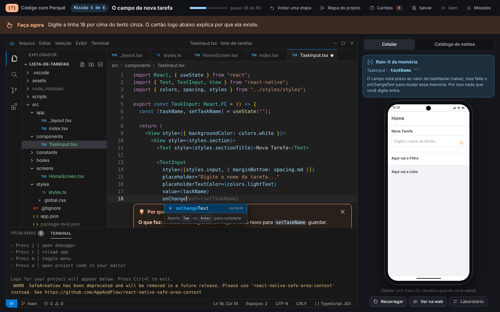

O desafio aqui não é adivinhar o código. O texto a digitar já aparece em cinza, e o editor acompanha o aluno o tempo todo. O que o simulador cobra é outra coisa: entender **para que serve** cada import, cada componente, cada estilo e cada linha de lógica do app.

O projeto simulado é o app **Lista de Tarefas**, feito com **React Native, Expo Router e TypeScript** a partir do modelo do Expo SDK 57 (`npx create-expo-app`).

## Sumário

- [Como abrir](#como-abrir)
- [Como jogar](#como-jogar)
- [Modos e opções](#modos-e-opções)
- [Regras](#regras)
- [As 6 missões](#as-6-missões)
- [Recursos do simulador](#recursos-do-simulador)
- [Atalhos de teclado](#atalhos-de-teclado)
- [Salvar e continuar depois](#salvar-e-continuar-depois)
- [Para o professor](#para-o-professor)
- [Estrutura de arquivos](#estrutura-de-arquivos)
- [Como mudar o conteúdo](#como-mudar-o-conteúdo)
- [Requisitos e privacidade](#requisitos-e-privacidade)
- [Autoria e créditos](#autoria-e-créditos)

## Como abrir

O simulador é feito só com HTML, CSS e JavaScript. Não tem instalação, servidor nem dependências.

**No computador, sem internet**

1. Baixe o repositório (botão **Code**, depois **Download ZIP**) e descompacte.
2. Abra o arquivo `index.html` no Google Chrome ou no Microsoft Edge.

**Pelo GitHub Pages**

1. No repositório, abra **Settings**, depois **Pages**.
2. Em **Build and deployment**, escolha **Deploy from a branch**, a branch `main` e a pasta `/ (root)`.
3. Salve. Em alguns minutos o simulador fica disponível no endereço que o GitHub mostrar.

## Como jogar

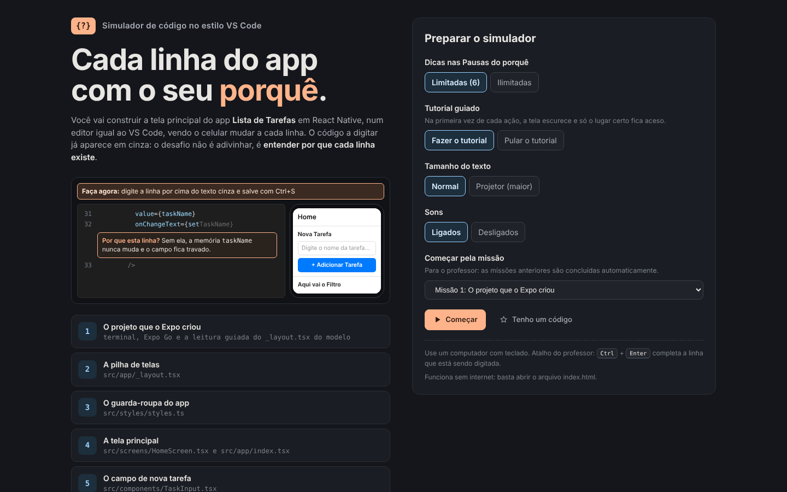

1. **Prepare o simulador.** Na tela inicial, escolha as opções (veja [Modos e opções](#modos-e-opções)) e clique em **Começar**.
2. **Siga o "Faça agora".** A faixa laranja no topo diz sempre o próximo passo: clicar no terminal, abrir um arquivo, digitar uma linha, salvar, testar no celular.
3. **Digite por cima do texto cinza.** Cada linha nova vem com um cartão que explica **o que ela faz** e **por que precisamos dela**.
4. **Salve com Ctrl+S e olhe o celular.** Como no Expo Go de verdade, o app só muda depois de salvar.
5. **Leia o resumo de cada bloco.** Quando um bloco termina, aparece o que ele faz e para que serve cada função usada nele.
6. **Responda à Pausa do porquê.** Cada missão tem duas perguntas. Acertou, ganha um cartão de conceito.
7. **Termine as 6 missões** e veja o relatório final, com o mapa do projeto, os cartões e o código completo de cada arquivo.

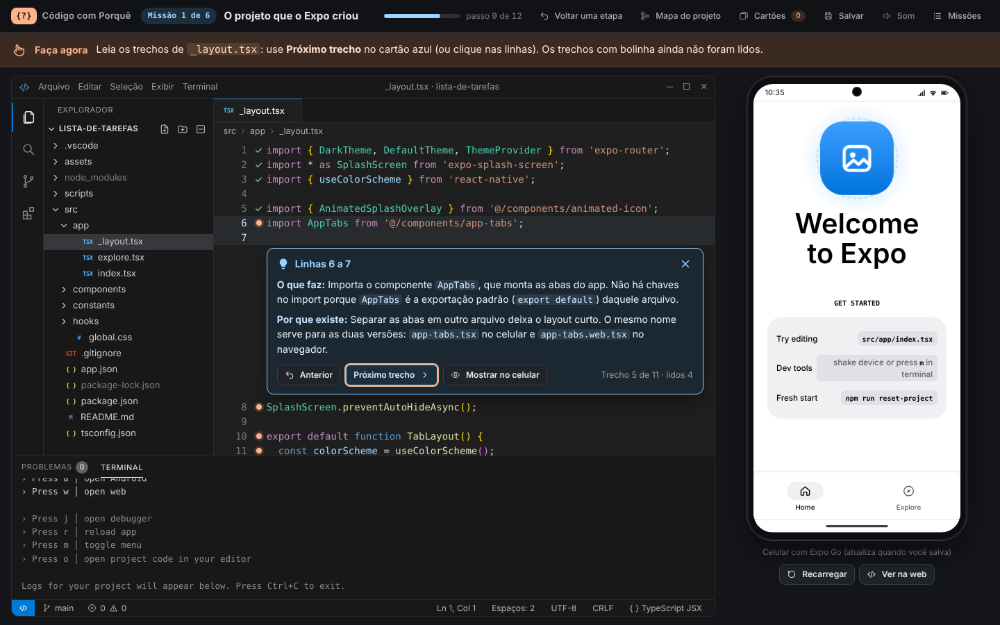

## Modos e opções

| Opção | Escolhas | O que muda |
|---|---|---|
| Dicas nas Pausas do porquê | **Limitadas (6)** ou **Ilimitadas** | No modo limitado, o aluno tem 6 dicas para o jogo inteiro. O botão de dica fica antes das alternativas. |
| Tutorial guiado | **Fazer o tutorial** ou **Pular o tutorial** | Na primeira vez de cada ação, a tela escurece e só o lugar certo fica aceso. O aluno faz a ação sozinho, e o tutorial pode ser pulado a qualquer momento. |
| Tamanho do texto | **Normal** ou **Projetor (maior)** | Aumenta o texto da interface e do código, para projetar na sala. |
| Sons | **Ligados** ou **Desligados** | Sons de digitação, acerto, erro e fim de missão. Também dá para trocar no botão **Som**, no topo. |
| Começar pela missão | Missão 1 a 6 | Para o professor: as missões anteriores são concluídas automaticamente. |

## Regras

- **O texto cinza é o caminho.** Só a tecla certa avança. Depois de três erros seguidos, aparece a dica da próxima tecla.
- **Linhas repetitivas entram com Tab.** As linhas com conceito novo são digitadas. As que só repetem um padrão, como boa parte dos estilos, aparecem com **Tab**, junto com um cartão explicando o grupo.
- **Import se faz pela lâmpada.** Quando um nome é usado sem import, o editor sublinha em vermelho. A correção vem pela lâmpada amarela (**Ctrl+.**). As opções que só escondem o erro (`@ts-ignore` e `@ts-nocheck`) são recusadas, com a explicação do motivo.
- **O celular obedece ao código salvo.** Arquivo não salvo não muda o app. Código com erro mostra a tela vermelha, como no Expo Go.
- **Pastas e arquivos têm nome certo.** Só se cria ou apaga um arquivo quando a missão pede. Nomes com maiúscula errada ou extensão faltando são recusados, com a explicação.
- **Errou uma pergunta?** Aparece um aviso na frente de tudo, com o porquê do erro e um botão **OK**. A alternativa errada fica riscada e o aluno tenta de novo.
- **Acertou?** Ganha um cartão de conceito, que fica guardado no botão **Cartões**.
- **Voltar uma etapa** desfaz o último passo, a qualquer momento.
- **Experimentos "E se?" não mudam o código.** Eles mostram o que aconteceria (por exemplo, sem o `default` ou sem o `TaskProvider`) e voltam ao normal com um clique.

## As 6 missões

| Missão | Título | O que o aluno faz | Pausa do porquê |
|---|---|---|---|
| 1 | O projeto que o Expo criou | Roda `npx expo start` no terminal, abre o app no Expo Go e faz a leitura guiada do `_layout.tsx` do modelo. | O atalho `@/` nos imports; o papel do `_layout.tsx` |
| 2 | A pilha de telas | Troca as abas do modelo por uma navegação em pilha (`Stack`) com o título Home. | Por que `export default`; o que faz o `Stack.Screen` |
| 3 | O guarda-roupa do app | Cria o `styles.ts` com cores, tamanhos de letra, espaços e estilos prontos (o design system do app). | Por que um arquivo só de estilos; o que o `StyleSheet.create` oferece |
| 4 | A tela principal | Cria a `HomeScreen.tsx` e transforma o `index.tsx` em ponte até ela. | Por que o `index.tsx` faz a ponte; import com chaves |
| 5 | O campo de nova tarefa | Cria o `TaskInput.tsx`, apaga os arquivos de exemplo da pasta `components` e escreve o campo com `useState`, campo controlado, botão e validação. | `value` com `onChangeText`; `trim()` e o `if` |
| 6 | A memória compartilhada | Cria o `TaskContext.tsx`, o `TaskItem.tsx` e o `TaskList.tsx`, e testa a lista com e sem o `TaskProvider`. | Contexto sem Provider; por que `setTasks([...tasks, newTask])` |

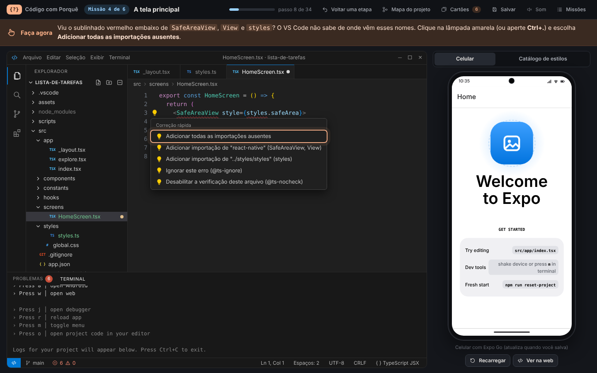

## Recursos do simulador

**Editor igual ao VS Code**
- Explorador de arquivos, abas, terminal com o Metro, painel de problemas e barra de status.
- IntelliSense: sugestões de nomes que se aceitam com **Tab** ou **Enter**.
- Sublinhado vermelho para nome sem import e lâmpada da Correção rápida.
- **Ctrl+clique** em nomes como `styles.input` abre o lugar onde eles foram criados.
- Cartões de glossário (268 termos) ao passar o mouse sobre o código.

**Celular de teste**
- Expo Go com QR code, app de exemplo do modelo, versão web no navegador e o nosso app, que muda a cada vez que o aluno salva.
- Alertas do Android, tela vermelha de erro e aviso amarelo no terminal, como no aparelho de verdade.
- O celular se ajusta ao tamanho da tela, inclusive em notebooks de 768 pixels de altura.

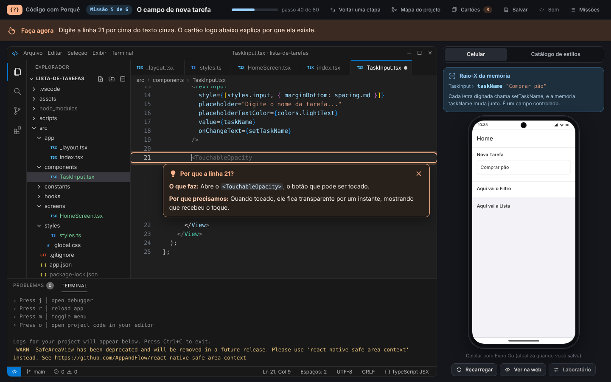

**Raio-X da memória.** Mostra o que cada componente guarda (o estado). Na missão 5, o aluno digita no celular e vê `taskName` mudar a cada letra.

**Catálogo de estilos.** Monta amostras ao vivo enquanto o aluno escreve o `styles.ts`: cada cor vira uma amostra, cada espaço vira uma régua e cada estilo vira uma prévia.

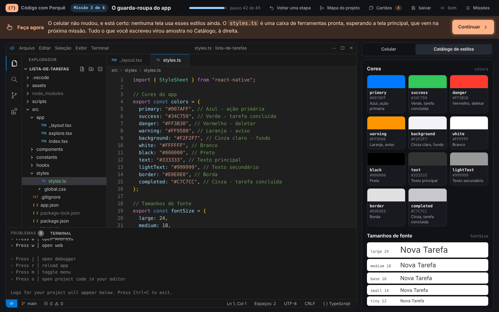

**Laboratório de estilos.** Testa outras cores, tamanhos de letra e espaços só no celular, sem mudar o código. Mostra em quais estilos cada valor é usado: um valor no `styles.ts`, o app inteiro muda junto.

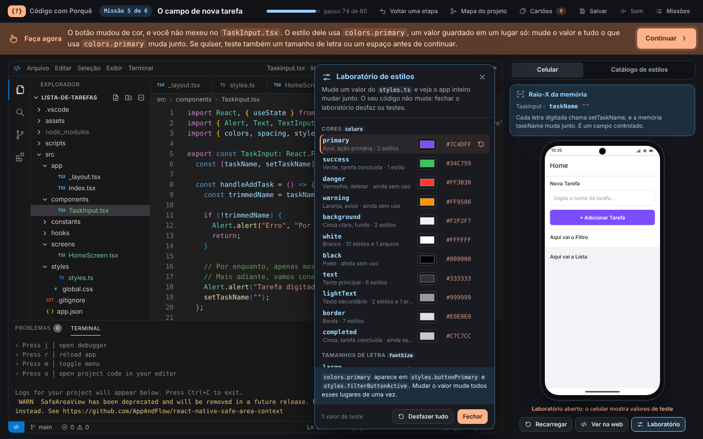

**Bancada.** Na missão 6, mostra o `TaskItem` e a lista vazia fora do app, enquanto o aluno escreve.

**Limpeza do projeto.** Na missão 5, o aluno apaga os arquivos de exemplo que o app não usa mais, selecionando vários de uma vez com **Shift** e **Ctrl**, como no VS Code. O `TaskInput.tsx` fica.

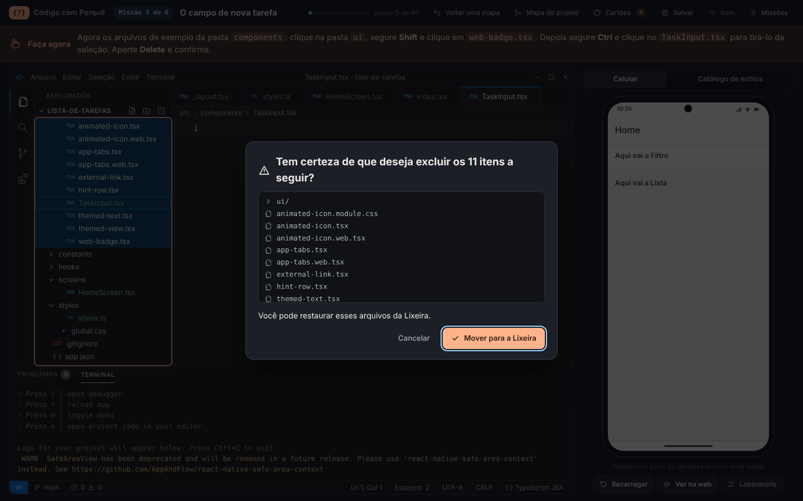

**Pausa do porquê e cartões de conceito.**

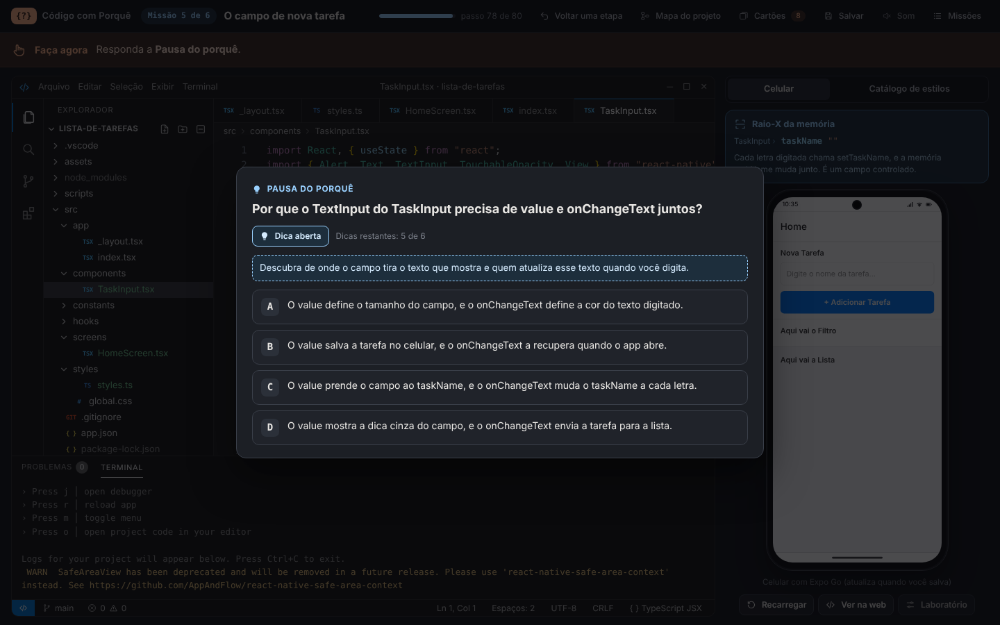

**Relatório final.** Resumo das missões, mapa do projeto, cartões conquistados e o código final dos 8 arquivos, com o papel de cada um e um botão para copiar tudo.

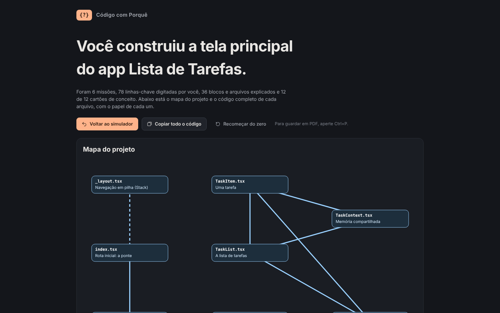

## Atalhos de teclado

| Atalho | O que faz |
|---|---|
| **Ctrl+S** | Salva o arquivo aberto (o celular atualiza) |
| **Tab** | Escreve as linhas cinza do grupo ou aceita a sugestão do IntelliSense |
| **Enter** | Aceita a sugestão do IntelliSense |
| **Ctrl+.** | Abre a Correção rápida (lâmpada amarela) |
| **Ctrl+clique** no código | Vai para o lugar onde o nome foi criado |
| **Ctrl+A** e **Delete** | Apaga todo o código do arquivo, quando a missão pede |
| **Shift+clique** e **Ctrl+clique** no Explorador | Seleciona vários arquivos |
| **Delete** no Explorador | Apaga os arquivos selecionados, quando a missão pede |
| **Esc** | Fecha menus e avisos |
| **Ctrl+Enter** | Atalho do professor: completa a linha que está sendo digitada |

## Salvar e continuar depois

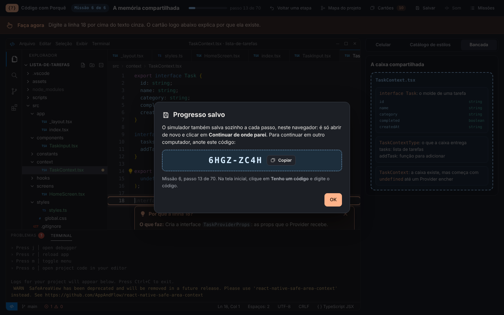

- **Automático:** o progresso é salvo neste navegador a cada passo. Ao abrir de novo, basta clicar em **Continuar de onde parei**.
- **Em outro computador:** o botão **Salvar**, no topo, mostra um código curto (por exemplo, `60G7-ZZ3H`). Na tela inicial do outro computador, clique em **Tenho um código** e digite esse código. O simulador volta exatamente para o mesmo passo, com as mesmas opções e os mesmos cartões.
- **No fim de cada missão**, a janela de missão concluída também mostra o código da próxima missão.
- O código tem uma conferência interna: se uma letra for digitada errado, ele é recusado em vez de levar para o lugar errado.

## Para o professor

- **Ctrl+Enter** completa a linha que está sendo digitada, útil para demonstrar sem digitar tudo.
- O botão **Missões**, no topo, leva a qualquer missão. As anteriores são concluídas sozinhas.
- O modo **Projetor (maior)** aumenta o texto para a projeção.
- No fim da missão 6, o código digitado pelo aluno é o app completo, linha por linha, o mesmo que vai para o projeto real no VS Code.

## Estrutura de arquivos

Os arquivos são separados por responsabilidade: estrutura, aparência, conteúdo e lógica.

```text
codigo-com-porque/
  index.html                  Estrutura das telas (preparo, simulador, relatório) e ícones
  README.md                   Este documento
  css/
    base.css                  Telas, faixas, botões, modais, perguntas, progresso e relatório
    editor.css                Janela do VS Code: explorador, abas, editor, terminal e menus
    celular.css               Celular, app de exemplo, nosso app, catálogo, bancada, Raio-X e laboratório
  js/
    dados/                    Conteúdo (pode ser editado sem mexer na lógica)
      arquivos.js             Código dos arquivos: modelo do Expo e app final
      explicacoes-modelo.js   Leitura guiada dos arquivos do modelo do Expo
      explicacoes-app.js      Explicações linha por linha e resumos de bloco do app
      glossario.js            Cartões do glossário e explicações de estilos
      perguntas.js            As 12 perguntas da Pausa do porquê e os cartões de conceito
      missoes.js              Roteiro das 6 missões, passo a passo
    nucleo/                   Lógica do simulador
      util.js                 Funções de apoio (textos, avisos, armazenamento)
      sons.js                 Sons feitos com a Web Audio API
      sintaxe.js              Cores do código (TSX, TS, CSS, JSON)
      estado.js               Estado do projeto: arquivos, salvamento e erros do TypeScript
      explorador.js           Árvore de arquivos, criação, seleção e exclusão
      editor.js               Digitação, IntelliSense, Correção rápida e Ctrl+clique
      terminal.js             Terminal e mensagens do Metro
      celular.js              Celular de teste, Expo Go, erros e o app desenhado a partir do código
      lado.js                 Abas do painel direito, catálogo, bancada e Raio-X
      laboratorio.js          Laboratório de estilos
      porque.js               Cartões do porquê, leitura guiada e resumos
      tutorial.js             Tutorial com holofote
      fluxo.js                Missões, passos, perguntas e "Voltar uma etapa"
      relatorio.js            Mapa do projeto, cartões e relatório final
      progresso.js            Botão Salvar e código de progresso
      app.js                  Tela inicial e ligação entre os módulos
  docs/
    imagens/                  Imagens deste README
```

## Como mudar o conteúdo

O conteúdo fica em `js/dados/` e pode ser editado sem tocar na lógica.

- **Textos dos passos:** em `missoes.js`, cada passo tem um tipo (`digitar`, `tab`, `salvar`, `quickfix`, `excluir` e outros) e um texto `faca`, que aparece na faixa "Faça agora".
- **Perguntas:** em `perguntas.js`, cada pergunta tem 4 alternativas, a correta, a dica, a explicação de cada erro e o cartão de conceito.
- **Explicações das linhas:** em `explicacoes-app.js` (app) e `explicacoes-modelo.js` (modelo do Expo), por número de linha.
- **Glossário:** em `glossario.js`, por nome do termo.

Ao mudar o número de passos de uma missão, os progressos salvos em navegadores e os códigos de progresso antigos podem deixar de apontar para o passo certo.

## Requisitos e privacidade

- Computador com teclado e um navegador atual (feito e testado no Google Chrome, também roda no Microsoft Edge).
- Tela a partir de 1366 por 768 pixels. Em telas menores, os painéis ficam um embaixo do outro.
- Funciona sem internet. Com internet, carrega a fonte Bricolage Grotesque do Google Fonts; sem ela, usa as fontes do sistema.
- **Nada é enviado para servidor nenhum.** O progresso fica só no navegador de quem joga (armazenamento local), e o código de progresso é gerado no próprio computador.

## Autoria e créditos

- **Autoria:** Prof. Alexandre, Instituto Federal Fluminense (IFF), Campus Maricá, Curso Técnico em Informática para Internet. ORCID: [0009-0006-6888-4692](https://orcid.org/0009-0006-6888-4692).
- **Uso:** disciplina de Linguagem de Programação para Aplicações Móveis.
- **Desenvolvimento:** construído com o apoio do Claude, da Anthropic.
- **Código do modelo:** os arquivos do app de exemplo exibidos no simulador vêm do modelo padrão do `create-expo-app` (Expo SDK 57), publicado pela Expo sob a licença MIT.
- **Fonte:** Bricolage Grotesque, distribuída pelo Google Fonts sob a SIL Open Font License.
- **Marcas:** Expo, React Native e VS Code são marcas de seus donos. Este projeto é educativo e não tem ligação oficial com eles.
